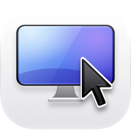

  <picture>
    <source media="(prefers-color-scheme: dark)" srcset="assets/icon-dark.png">
    
  </picture>

<h1 align="center">Remora</h1>

A fast native remote desktop client for the Mac that speaks RDP and VNC, and gives your AI agents computer use on every machine you connect to.

  

<!-- SCREENSHOT: paste the GitHub user-attachments URL into src below, then remove these comment markers.

  

-->

## Highlights

- **RDP and VNC**: Connect to Windows, Linux and Mac machines, each session in its own tab.
  - RDP runs on FreeRDP.
  - VNC runs on LibVNCClient and works with Apple Screen Sharing on a Mac.
  - The experimental Apple mode uses Apple Screen Sharing's faster, lossy encoding.
- **Fast and sharp**: A Metal renderer and H.264 decoded by VideoToolbox keep the remote desktop sharp and responsive, at full Retina resolution on RDP.
- **Menu bar app**: Close the window, and your sessions keep running in the menu bar.
- **Computer use for AI agents**: Through the `remora` CLI, your agents see, click and type on any remote machine while you watch. You can take over or stop them at any moment.
- **Screenshots and recordings**: Capture a screenshot or record HEVC video, even from a tab you are not looking at.
- **Shared clipboard**: Text you copy on the Mac pastes on the remote machine, and the other way around.
- **Secure**: Passwords stay in your keychain. When a VNC server offers VeNCrypt, Remora requires certificate TLS and never falls back to a weaker method.
- **CLI**: `remora` can do almost everything the app can. Run `remora --help` to see what it offers.

## Install

Remora runs on Apple silicon Macs with macOS 26 or later.

Download the DMG from the [latest release](https://github.com/sadiksaifi/remora/releases/latest), open it, and drag Remora to Applications.

To give your AI agents Remora, open Settings > Command Line:

- **Command-line tool**: Install puts `remora` in `~/.local/bin`.
- **Agent skill**: Install links the skill into `~/.claude/skills` for Claude Code, and into `~/.agents/skills` for Codex, OpenCode, Cursor and other agents.

## How agents use Remora

- An agent runs `remora` commands. The CLI passes them to the running app over a local socket that only your account can open.
- While an agent controls a session, you see its pointer on the remote desktop.
- Take Over pauses the agent and gives you the session until you press Resume.
- Stop Agent Control locks the agent out of the session until you press Resume.
- Both are in the session's tab menu and in the menu bar.

## More

- **Agent skill**: The rules agents follow are in [skills/remora/SKILL.md](skills/remora/SKILL.md).
- **Engines**: How the FreeRDP and LibVNCClient engines are built and patched is in [Vendor/README.md](Vendor/README.md).
- **Development**: Run `mise tasks` to list the build, test and lint tasks, and read [AGENTS.md](AGENTS.md) before you contribute.

## License

Remora is open source under the [GNU GPL v3](LICENSE).
