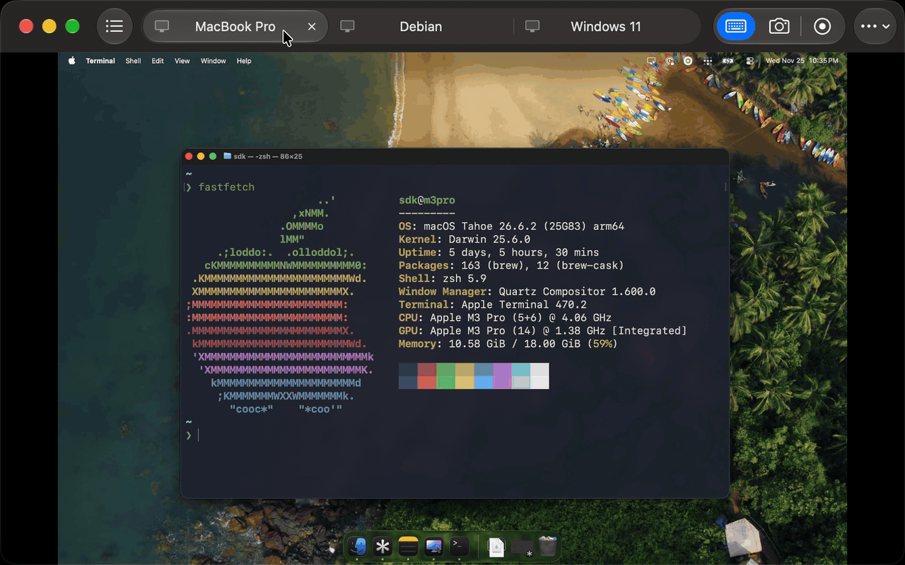

  <picture>
    <source media="(prefers-color-scheme: dark)" srcset="assets/icon-dark.png">
    
  </picture>

<h1 align="center">Remora</h1>

A fast native remote desktop client for the Mac that speaks RDP and VNC, and gives your AI agents computer use on every machine you connect to.

  

  

## Highlights

- **Protocols**: Remora supports both RDP and VNC, so you can connect to Mac, Linux and Windows machines.
- **Rendering**: Metal and hardware video decoding keep the remote desktop sharp and responsive.
- **Computer use**: Your AI agents, such as Claude Code and Codex, can drive your remote machines.
- **Screen capture**: Take a screenshot or record a video of any remote desktop.
- **Shared clipboard**: Copy on one machine and paste on the other.

## Install

Download the DMG from the [latest release](https://github.com/sadiksaifi/remora/releases/latest), open it, and drag Remora to Applications.

> [!NOTE]
> Remora supports only Apple silicon Macs with macOS 26 or later.

To give your AI agents Remora, open Settings > Command Line:

- **Command-line tool**: Install puts `remora` in `~/.local/bin`, and offers PATH setup if your shell does not find it.
- **Agent skill**: Install links the skill into `~/.claude/skills` for Claude Code, and into `~/.agents/skills` for Codex, OpenCode, Cursor and other agents.

## License

Remora is open source under the [GNU GPL v3](LICENSE).
